<p align="center">
  
</p>

<h1 align="center">Naadi (नाड़ी)</h1>

<h3 align="center">Delhi's bus travel times, measured by the buses themselves.</h3>

<p align="center">
A travel-time model, door-to-door journey planner and open API for Delhi's buses, built on the Delhi Transport Stack.<br/>
Every bus is a moving traffic sensor. <i>Dilli ki naadi, har pal</i>: Delhi's pulse, every moment.
</p>

<p align="center">
  
  
  
  
</p>

<p align="center">
  
  
  
  
  
  
  
  
  
  
  
  
  
  
</p>

<p align="center">
  <a href="https://13-235-147-97.sslip.io/"><b>🌐 Live app</b></a> •
  <a href="https://13-235-147-97.sslip.io/api/docs"><b>📘 API docs</b></a> •
  <a href="#-demo"><b>🎬 Demo</b></a> •
  <a href="docs/TECHNICAL_NOTE.md"><b>📐 Technical note</b></a> •
  <a href="docs/VALIDATION_REPORT.md"><b>📊 Validation report</b></a> •
  <a href="docs/PROPOSAL.md"><b>📝 Proposal</b></a>
</p>

> Delhi's bus timetable runs every stop-to-stop hop at the same 18 km/h, all day. Real buses do 35 km/h at 2 a.m. and 16 km/h at 6 p.m. So the timetable, and every planner built on it, can't tell a commuter whether a trip takes 40 minutes or 90.
>
> **Naadi** learns how long every stretch of every route really takes, at every hour, from 31 days of bus GPS: 38 million timed stop-to-stop bus runs. It corrects those times with what buses are doing right now, measures waits from the gaps between the buses that actually came, and plans door to door with an honest range, in Hindi and English. Every claim is tested on days the model never saw.

<p align="center">
  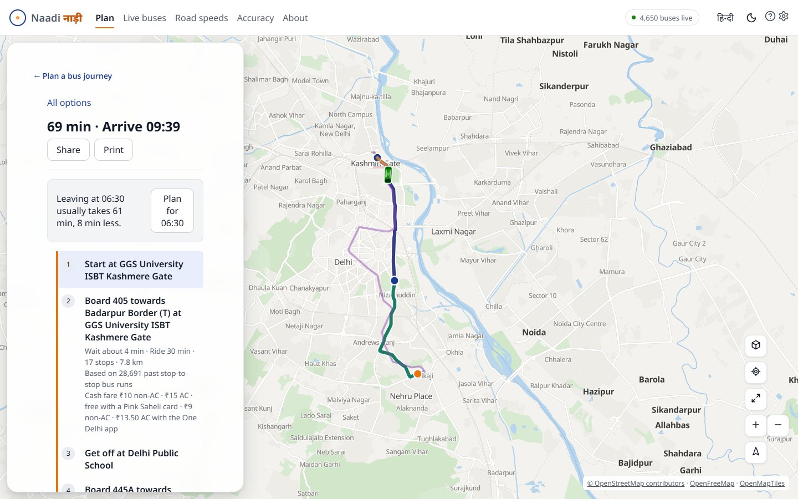
  <br/><sub>The brief's own example, Kashmere Gate ISBT → Nehru Place at 08:30 on a Tuesday: 69 minutes door to door, usually 59 to 109, with a bus driving the route.</sub>
</p>

---

## 📊 Results at a glance

Every test is held out: history comes only from days before the test days, and nothing is fitted on them. Full methods and caveats: [validation report](docs/VALIDATION_REPORT.md).

| Test | Naadi | Compared with |
| --- | --- | --- |
| Bus arrival at a stop, 1 to 30 stops ahead (1,987,389 predictions, 26–31 Oct) | **2.2 min** (133.3 s) | Published timetable 4.6 min (273.6 s); best of 8 other methods 2.6 min |
| Time on the bus, one ride of 5 to 40 stops (2,876,808 rides) | **4.3 min** on a 33-min ride (13.1%); 90.4% within 10 min | — |
| Door to door, replayed on the buses that really ran (3,598 journeys, 29–31 Oct) | **15.5 min** | Timetable planner 22.9 min |
| Google Maps bus directions, both replayed (91 trips, 15–16 Nov) | **12.3 min** | Google Maps 36.5 min |
| The organisers' ETA Calculator, scored from the same bus position (9,616 answers) | **7.4 min** | ETA Calculator 9.7 min |
| 80% ranges | Held the real journey time **78%** of the time | — |

<p align="center">
  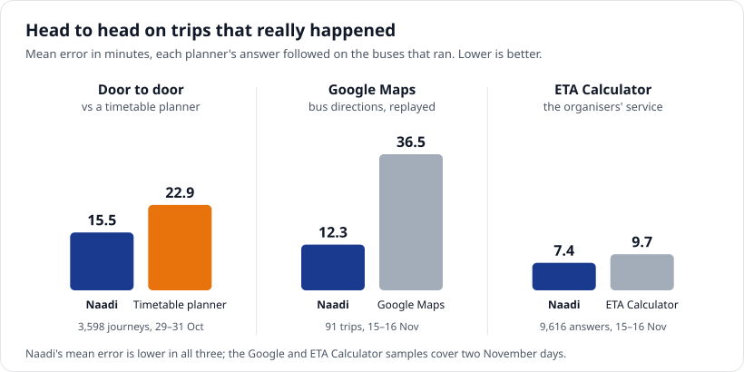
</p>

---

## 🎬 Demo

<p align="center">
  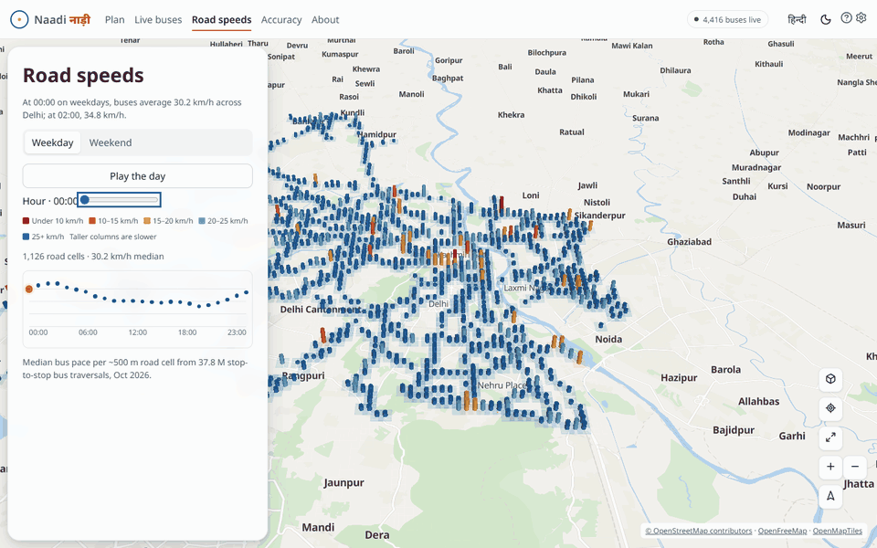
  <br/><sub>Road speeds through an ordinary weekday, hour by hour. Taller, redder columns are slower roads.</sub>
</p>

- **Try it:** https://13-235-147-97.sslip.io/ and press "Show this journey" for the brief's example.
- **Demo video:** _the link goes here once it's uploaded_ (script: [docs/DEMO_VIDEO_SCRIPT.md](docs/DEMO_VIDEO_SCRIPT.md)).
- **Ask the API:** [`/api/journeys?from=28.665476,77.230173&to=28.548700,77.256981&depart=2026-11-24T08:30`](https://13-235-147-97.sslip.io/api/journeys?from=28.665476,77.230173&to=28.548700,77.256981&depart=2026-11-24T08:30)

---

## 💡 The problem, and who it helps

Problem 1 asks for a "Google Maps-like" model of bus travel times between any two places in Delhi, using the bus fleet as a proxy for traffic, plus an API that returns journey options and estimates that hold up against real trips and against Google Maps.

- **The timetable doesn't know the time of day.** Its stop-to-stop times are a constant-speed template (18.01 km/h). Measured weekday speeds run from 34.8 km/h at 02:00 to 16.3 km/h at 18:00.
- **Waits are the biggest unknown.** Many live trips aren't in the timetable at all, so a scheduled departure minute means little. In our door-to-door replay, waiting, not riding, causes most of the error.
- **Existing answers are timetable-based.** Google's Delhi bus answers for a Friday and a Tuesday at 08:30 were identical to the second; replayed on the buses that ran, they were 36.5 minutes off on average.

**Who it helps:** commuters, who get a realistic time and the quieter hour; operators and planners, who get measured speeds and reliability by stretch and hour; and the Transport Stack, which gets an open travel-time component it can plug into its own journey planner and ETA Calculator.

<p align="center">
  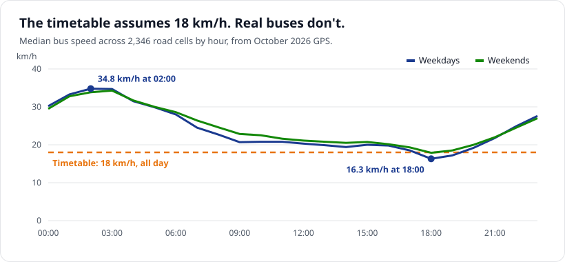
</p>

---

## ⚙️ How it works

| Step | What happens | Behind it |
| --- | --- | --- |
| 🛰️ **Read the fleet** | 31 days of October 2026 GPS (560 M positions after cleaning) are snapped to each route's own shape | DuckDB over Parquet; 78% of points matched, median offset 7.4 m |
| ⏱️ **Time every stretch** | Stop crossings are interpolated, giving 38 M stop-to-stop traversals over 86% of the network's links | Bus runs rebuilt from GPS, since the feed's trip ids change mid-run |
| 🧠 **Learn the hours** | History at five levels (link-hour, link, stop pair, road cell, city) feeds a LightGBM model of mean link time by hour and day type | Empirical-Bayes shrinkage, so thin data borrows from the same road |
| 📡 **Correct it live** | Stretches driven in the last 20 minutes adjust the times, fading with how far ahead the bus will be | Live GTFS-RT every 10 s; tuned on one day, tested on six others |
| 🚏 **Measure the waits** | Expected waits come from the real gaps between buses (bunching included); leaving now, from the bus actually approaching | E[W] = Σh² / 2Σh per route, stop and hour |
| 🗺️ **Plan door to door** | RAPTOR finds up to three options with walking, boarding stop, route(s), changes and total; "take 405 or 402 or 411, whichever comes first" | Common-lines strategy; OpenStreetMap street walking; e-ticket fares |
| 📏 **Say how sure** | Each answer has an 80% range, a sample count and the same trip at every hour (SamayChakra) | Grouped split-conformal ranges |

---

## 🧭 Product tour

### Plan a journey

<table>
  <tr>
    <td width="62%">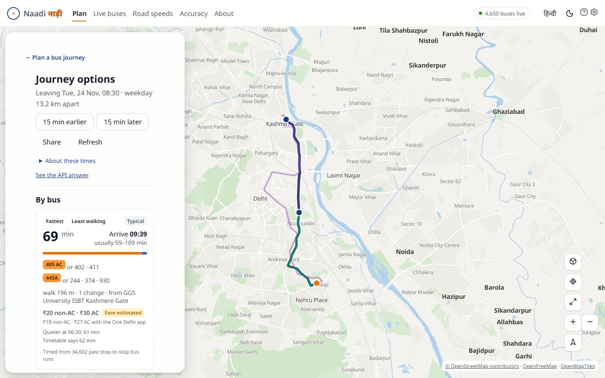</td>
    <td>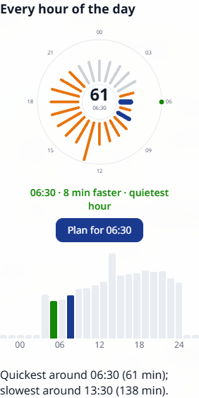</td>
  </tr>
  <tr>
    <td><sub><b>Journey options.</b> Fastest, fewest changes and least walking; "usually 59–109 min"; a walk, wait and ride bar; "405 or 402 · 411, whichever comes first"; cash and One Delhi app fares; "Quieter at 06:30: 61 min" and what the timetable says.</sub></td>
    <td><sub><b>SamayChakra (समयचक्र).</b> Like the Ashoka Chakra, 24 spokes: one per hour, each the same trip at that hour. One tap plans the quieter hour.</sub></td>
  </tr>
</table>

### Delhi right now, and live buses

<table>
  <tr>
    <td width="36%">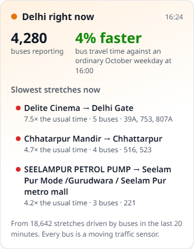</td>
    <td>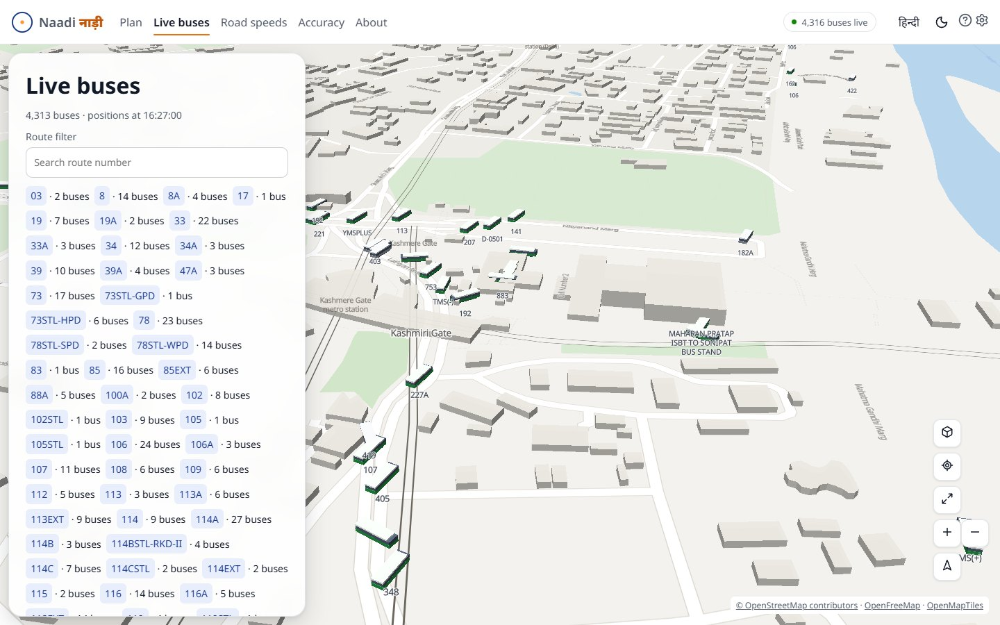</td>
  </tr>
  <tr>
    <td><sub><b>Delhi right now.</b> Live bus travel times against an ordinary October day at the same hour, and the slowest stretches of the last 20 minutes; the home map glows where buses are.</sub></td>
    <td><sub><b>Live buses.</b> Clusters when zoomed out, then a bus icon facing its direction of travel, then 3D buses (here at ISBT Kashmere Gate). Bus ids are salted hashes; licence plates are never shown.</sub></td>
  </tr>
</table>

### Every route, every stop, every road

<table>
  <tr>
    <td>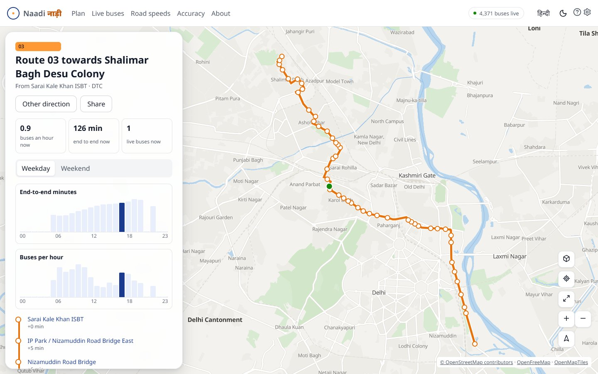</td>
    <td>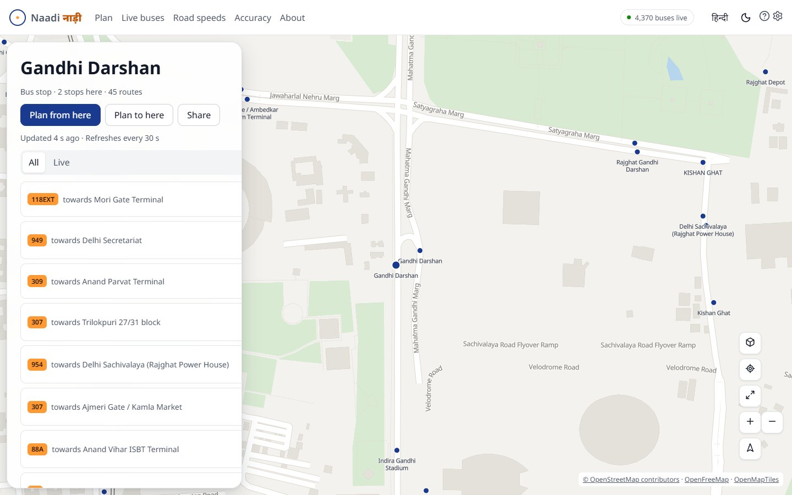</td>
  </tr>
  <tr>
    <td><sub><b>Routes.</b> End-to-end time and buses per hour through the day, weekday or weekend, with live buses on the stop list.</sub></td>
    <td><sub><b>Stops.</b> A live departures board, refreshed every 30 s, with typical waits where no bus is tracked.</sub></td>
  </tr>
  <tr>
    <td>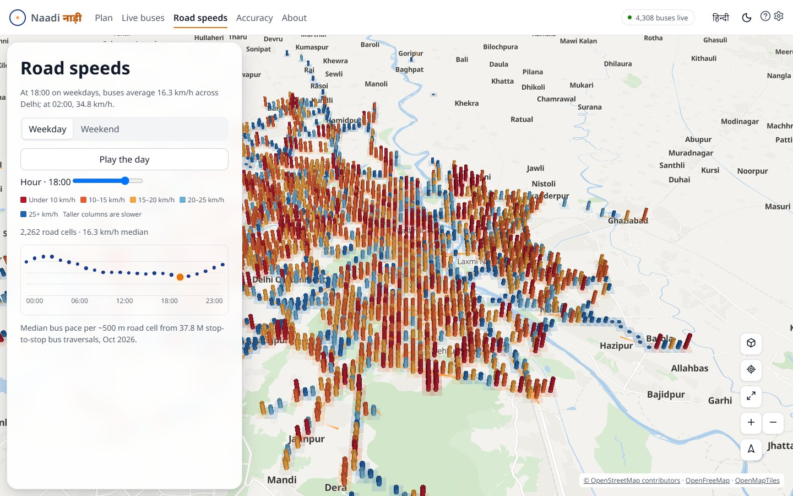</td>
    <td>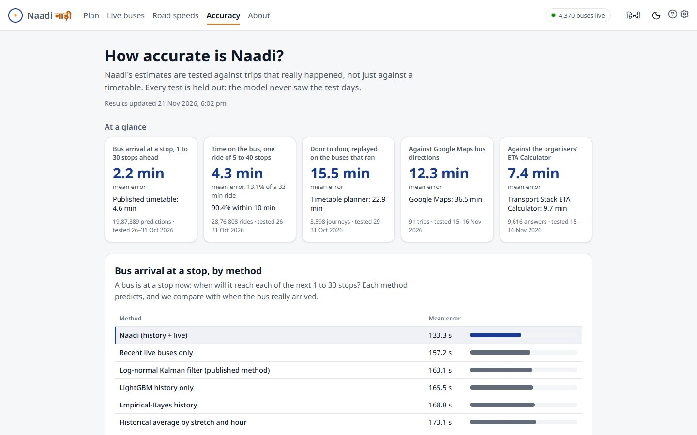</td>
  </tr>
  <tr>
    <td><sub><b>Road speeds.</b> Median bus speed on 2,346 road cells by hour; "Play the day" animates real bus trails.</sub></td>
    <td><sub><b>Accuracy.</b> The held-out results, method by method, inside the app.</sub></td>
  </tr>
</table>

### In Hindi, in the dark, on a phone

<table>
  <tr>
    <td width="50%">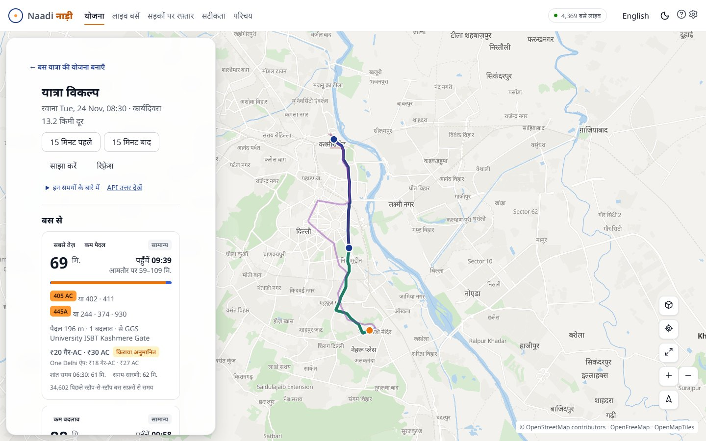</td>
    <td width="50%">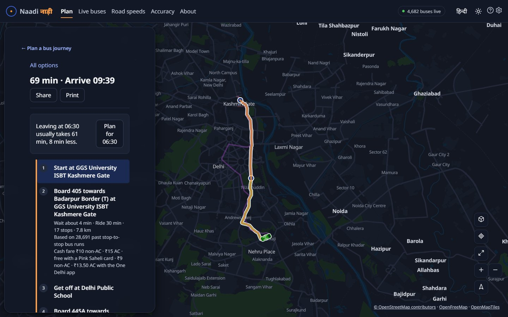</td>
  </tr>
</table>

<p align="center">
  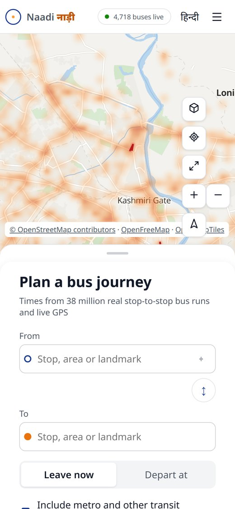
  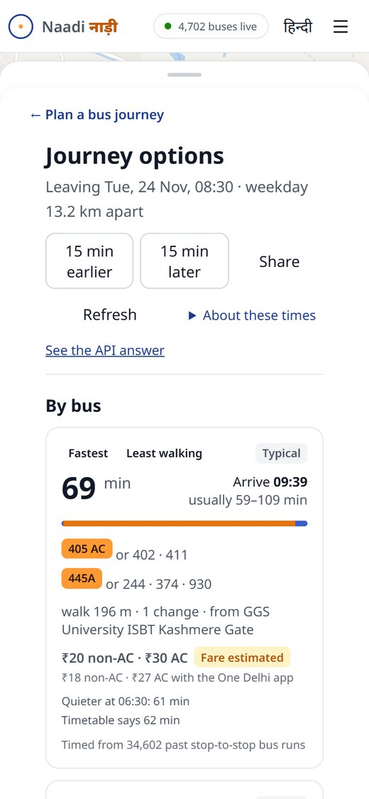
  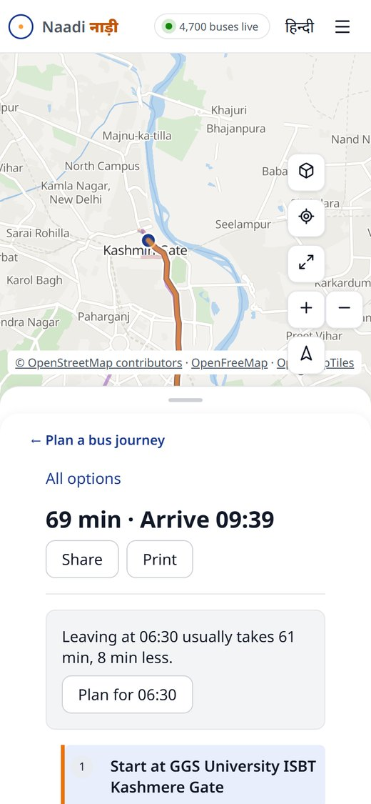
</p>

---

## 🎯 Fit to the Problem 1 brief

| The brief asks for | Naadi |
| --- | --- |
| A travel-time model that uses the bus fleet as a traffic proxy | 38 M measured traversals → link times by hour and day type, corrected live ([technical note §3–4](docs/TECHNICAL_NOTE.md)) |
| GPS-to-route linking, per-stretch times, live plus history, behaviour with little data | Shape snapping, stop crossings, five-level history with shrinkage, a nowcast that borrows from the same road ([§2–4](docs/TECHNICAL_NOTE.md)) |
| A documented API: `GET /journeys?from=…&to=…&depart=…` returning options as JSON | 19 endpoints with OpenAPI docs, plus one shaped like the organisers' journey planner |
| Options with the walk, boarding stop, route, alighting stop, changes, final walk and total | All of these, plus waits, fares, an 80% range and the next live buses |
| Different answers by time of day, and the trip at a quieter hour | SamayChakra and "Quieter at 06:30: 61 min" on every option |
| A map-based screen to inspect results | A full web app: installable, Hindi and English, light and dark |
| Estimates checked against actual trips and Google Maps | Four held-out tests, including a replay on the buses that ran and a head-to-head with Google ([validation report](docs/VALIDATION_REPORT.md)) |
| README, technical note, demo video, proposal; no mock-only entries | This README, [technical note](docs/TECHNICAL_NOTE.md), [demo script](docs/DEMO_VIDEO_SCRIPT.md), [proposal](docs/PROPOSAL.md); real data throughout |

**What's distinctive:**

1. **Waits measured from real gaps between buses**, not half the timetable headway; for "leave now", the first wait comes from the bus actually approaching.
2. **Common lines inside RAPTOR**: "take 405 or 402 or 411, whichever comes first", the way Delhi riders travel.
3. **A live nowcast** from stretches driven in the last 20 minutes, borrowing from the same road when a route has no recent bus.
4. **Eight baselines in one held-out test**, including a published log-normal Kalman filter, with paired bootstrap confidence intervals.
5. **Door-to-door replay on the buses that actually ran**, walk, wait and ride, used to score Naadi, a timetable planner and Google alike.
6. **Calibrated 80% ranges** (grouped split-conformal) that held the real time 78% of the time.
7. **Honest extra modes:** metro, Namo Bharat and shared autos as labelled timetable estimates, with a test that bus options don't change when they're added.
8. **Real fares** from October e-tickets (exact 93.4% of the time where the table has data) and **street walking** from OpenStreetMap.

---

## 📈 Accuracy

<p align="center">
  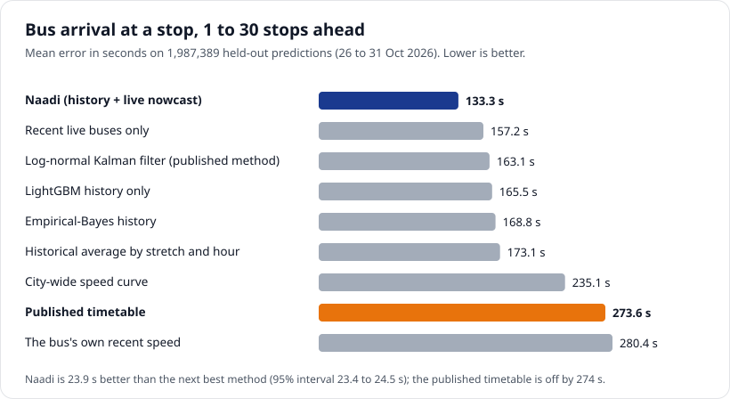
</p>
<p align="center">
  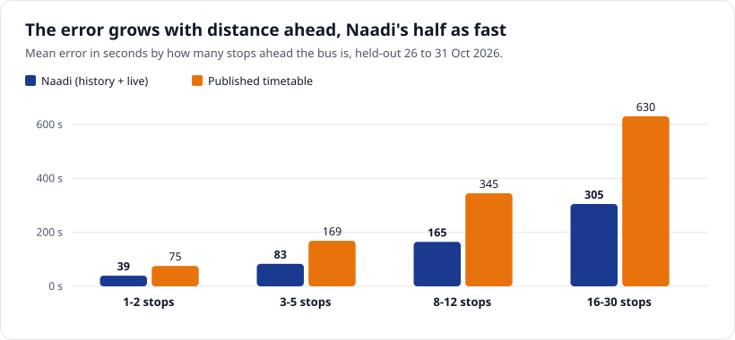
</p>

- **Held out, every time.** History 1 to 24 Oct; nowcast tuned on 25 Oct; tested 26 to 31 Oct. Door-to-door factors fitted on 25–26 Oct, ranges calibrated on 27–28 Oct, reported on 29–31 Oct.
- **Like for like with ride-only results.** Other entries report rides on one bus; Naadi's is 4.31 min on a 32.96-min ride (13.1% of ride time; 90.4% within 10 min). Door to door with the wait for the bus is the stricter test, and it's the one riders feel.
- **Fair to the baselines.** The ETA Calculator is scored from the same GPS fix as Naadi, on the same vehicle run; its answers used positions a median of 266 s old, so fresher positions would improve it. Google's own itinerary is replayed on the buses that ran, line by line.
- **Known limits.** The door-to-door test used straight-line walking (the app now uses streets, and the test will be re-run); the Google and ETA Calculator samples cover two November days (one was Chhath Puja, the other foggy); every method predicts arrivals early on average, Naadi by about 7 s one stop ahead and 251 s at 30 stops.

All figures come from [`validation/results/`](validation/results) and are rebuilt by `scripts/build_summary.py`; the charts by `scripts/build_docs_figures.py`.

---

## 🏗️ Architecture

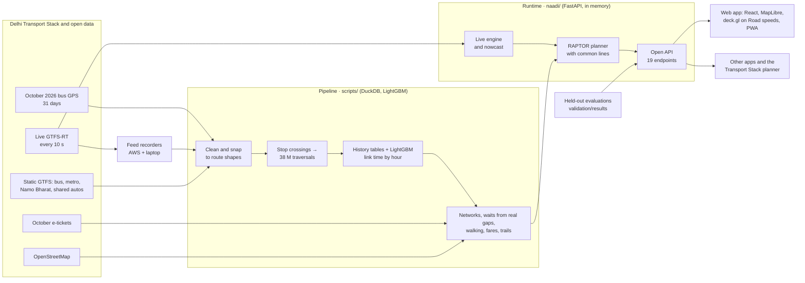

| Component | Technology | Purpose |
| --- | --- | --- |
| **Pipeline** (`scripts/`, 38 files) | DuckDB, PyArrow, LightGBM, NumPy, osmium | Ingest and clean GPS, match to routes, stop crossings, traversals, history tables, the link-time grid, observed service levels, networks, walking, fares, trails, evaluations |
| **Runtime** (`naadi/`, 16 modules) | FastAPI, Uvicorn, NumPy, Numba | Link-time grid, nowcast, live engine, RAPTOR with common lines, multimodal legs, walking, fares, the organiser-shaped adapter. No database: arrays in memory, 0.3 to 0.6 s per journey |
| **Web app** (`web/`) | React 19, TypeScript, Vite 6, MapLibre GL 5, TanStack Query, React Router 7, deck.gl (Road speeds only) | Planner, journey detail, live buses, routes, stops, road speeds, accuracy; installable PWA; Hindi with correctly shaped Devanagari map labels |
| **Hosting** (`infra/`) | AWS EC2 t4g.small (Mumbai), S3, SSM, Caddy | HTTPS on sslip.io, deploys over SSM with automatic rollback, per-address rate limits, about US$0.4 a day under a US$20 budget |
| **Quality** (`tests/`, `web/e2e/`) | pytest, Vitest, Playwright, axe | 47 Python tests, 7 unit tests, 60 mocked browser tests and 12 real-data browser tests per viewport, including request budgets for every screen |

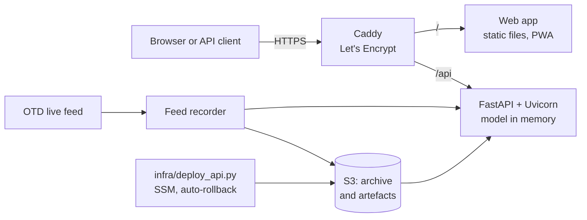

**Why these tools:** DuckDB processes a 124 GB month of GPS on one laptop without a database server; LightGBM with a gamma objective predicts mean times, which add up along a ride where medians don't; Numba keeps a RAPTOR query to about 0.1 s; MapLibre with OpenFreeMap tiles keeps the map open and free; deck.gl is loaded only on the page that needs it, so the first visit stays small.

---

## 🔌 API

Base address: `https://13-235-147-97.sslip.io/api` · interactive docs at [`/api/docs`](https://13-235-147-97.sslip.io/api/docs) · OpenAPI file: [`docs/openapi.json`](docs/openapi.json)

```bash
curl "https://13-235-147-97.sslip.io/api/journeys?from=28.665476,77.230173&to=28.548700,77.256981&depart=2026-11-24T08:30&modes=bus"
```

```jsonc
{
  "query": { "from": { "name": "28.66548, 77.23017", … }, "depart": "2026-11-24T08:30+05:30", "day_type": "weekday", "live": false, "crow_km": 13.2 },
  "options": [{
    "labels": ["fastest", "least_walking"],
    "total_min": 69.4, "range_min": [59, 109], "arrive": "2026-11-24T09:39+05:30",
    "transfers": 1, "walk_m": 196, "wait_min": 9.9, "ride_min": 56.0,
    "fare_inr": { "non_ac": 20.0, "ac": 30.0, "pink_saheli": 0 },
    "quiet_hour": { "hour": 6, "total_min": 60.8 }, "timetable_min": 61.7,
    "samay_chakra": [null, null, null, null, null, 71.2, 60.8, 62.5, 69.4, 79.5, …],
    "legs": [
      { "type": "walk", "minutes": 0.0 },
      { "type": "bus", "route": "405", "also": ["402", "411"], "towards": "Badarpur Border (T)",
        "board": { "name": "GGS University ISBT Kashmere Gate" }, "alight": { "name": "Delhi Public School" },
        "wait_min": 4.2, "ride_min": 29.5, "stops": 17, "history_samples": 28691 },
      { "type": "bus", "route": "445A", "also": ["244", "374", "930"], … },
      { "type": "walk", "minutes": 3.5, "metres": 195 }
    ]
  }]
}
```

| Endpoint | What it returns |
| --- | --- |
| `GET /journeys` | Up to 5 options (`from`, `to` as `lat,lon`, `stop:<id>` or a name; `depart` or `arrive`; `modes`) |
| `GET /v2/get_multi_modal` | The same options in the shape of the organisers' journey-planner API (`src`, `dst`, `mode`, `time`) |
| `GET /stops/search` · `/stops/nearby` · `/stops/all` | Stops by name, by distance, or all of them |
| `GET /stops/{id}/departures` | Live next buses and typical waits, each with its route id |
| `GET /routes/search` · `/routes/{id}` | Routes by number; a route's stops, shape and hourly times and frequency |
| `GET /live/buses` · `/vehicles` · `/legs/next-buses` | Live positions with anonymised ids; the next buses for one leg |
| `GET /pulse` | Delhi right now: buses reporting, travel time against an ordinary day, slowest stretches |
| `GET /speeds/cells` · `/trails/index` · `/trails/{day}/{hour}` | Road speeds by hour; bus trails for the playback |
| `GET /accuracy` · `/about` · `/health` · `/capabilities` | Published results, version, live status |

Rate limits: 600 requests a minute per address, 60 of them for `/journeys`; a refusal is HTTP 429 with `Retry-After`. The web app shares identical requests, throttles itself and waits out a 429 on its own.

---

## 🔨 What we built during the hackathon

Everything in this repository was written during Phase 1 of the Transport Stack Hackathon 2026: the first commit is from 15 Nov 2026, and there are over 110 commits since. That covers the data pipeline, the travel-time model and nowcast, the planner, the API, the web app, the AWS deployment, the evaluations and these documents.

Pre-existing work we build on, all credited below: the Transport Stack data; open-source libraries; OpenStreetMap data and OpenFreeMap tiles; Photon (komoot) for place search; the MapLibre complex-text plugin for Devanagari shaping; and published methods (RAPTOR, optimal strategies for common lines, empirical-Bayes shrinkage, gradient-boosted trees, split-conformal prediction, a log-normal Kalman filter baseline).

---

## 🚀 Run it yourself

**Just the web app, against the live API (5 minutes):**

```powershell
cd web
npm ci
npm run dev        # http://localhost:5173, /api goes to the live API
```

**The whole thing:** Python 3.11+, Node 20+, and about 40 GB of disk for the October archive. The pipeline takes about two hours on a 16-thread laptop, mostly the archive ingest. The commands are for Windows PowerShell; on macOS or Linux use `.venv/bin/python` and forward slashes.

```powershell
python -m venv .venv
.venv\Scripts\python.exe -m pip install -r requirements.txt
# data from https://delhi.transportstack.in into the repo root, keys in .env (copy .env.example)
.venv\Scripts\python.exe scripts\ingest_dtc_hist.py
.venv\Scripts\python.exe scripts\gtfs_fix.py
.venv\Scripts\python.exe scripts\match_routes.py
.venv\Scripts\python.exe scripts\build_speed_tables.py
.venv\Scripts\python.exe scripts\rebuild_all.py --from-step 3
.venv\Scripts\python.exe -m uvicorn naadi.api:app --port 8000
```

Step-by-step instructions, the extra build steps (walking, fares, trails, summary) and every test command: [docs/LOCAL_DEVELOPMENT.md](docs/LOCAL_DEVELOPMENT.md). Testing by hand: [docs/MANUAL_TESTING.md](docs/MANUAL_TESTING.md). Deploying: `python infra/deploy_api.py` (AWS profile `naadi`).

**Tests:**

```powershell
.venv\Scripts\python.exe -m pytest -q tests                  # 47 tests
cd web; npm run test; npm run e2e                             # unit tests; browser tests on a mocked API
$env:NAADI_BASE_URL='https://13-235-147-97.sslip.io'; npx playwright test -c playwright.live.config.ts   # real data
```

---

## 📁 Repository

| Path | Contents |
| --- | --- |
| [`naadi/`](naadi) | Runtime: link-time grid, nowcast, network, RAPTOR router, common lines, live engine, walking, fares, replay, FastAPI app |
| [`scripts/`](scripts) | Pipeline and evaluations: ingest, match, stop crossings, tables, model, service levels, networks, evaluations, Google sampler, figures |
| [`web/`](web) | React + MapLibre web app, Playwright and Vitest tests |
| [`infra/`](infra) | AWS: a least-privilege deploy user, the recorder server, the API deploy with Caddy and rollback |
| [`validation/`](validation) | The fixed origin–destination set and every published result (aggregates only) |
| [`docs/`](docs) | [Technical note](docs/TECHNICAL_NOTE.md), [validation report](docs/VALIDATION_REPORT.md), [proposal](docs/PROPOSAL.md), [OpenAPI](docs/openapi.json), [web app](docs/WEB_APP.md), [local development](docs/LOCAL_DEVELOPMENT.md), [manual testing](docs/MANUAL_TESTING.md), [demo script](docs/DEMO_VIDEO_SCRIPT.md), images |
| [`research/`](research) | The [hackathon brief](research/00-hackathon-brief.md) and the [dataset audit](research/03-dataset-audit.md) |
| [`tests/`](tests) | pytest suite |

---

## 🔮 What's next (Phase 2)

- **Feeder routes (Problem 4):** the hourly stretch-time grid is the "traffic conditions" input the brief asks for, across the whole network.
- **Crowding (Problem 5):** e-ticket and AFC load as a third criterion in the router, which already trades time against changes.
- **Reliability for operators:** bunching, unreliable stretches and how realistic each route's timetable is, by hour.
- **Accuracy:** an out-of-time November test, the door-to-door replay with street walking, bias correction by distance ahead, and a larger Google sample.
- **Open components:** published model tables for one-command setup, and a GTFS-RT TripUpdates feed so any app can use the predictions.

---

## 📜 Data, privacy and credits

- **Data:** Delhi Transport Stack (delhi.transportstack.in) and Delhi Open Transit Data (Department of Transport, GNCTD; IIIT-Delhi). Raw data isn't redistributed, as Transport Stack Licence 1.0 requires; this repository holds code and aggregate results only.
- **Privacy:** vehicle ids (licence plates) never leave the pipeline; the public API returns salted hashes, and the salt lives in AWS SSM. The app has no accounts, tracking or analytics; settings and saved places stay on the device. Place search sends the typed text to Photon (komoot).
- **Map:** © OpenStreetMap contributors; tiles by OpenFreeMap; OpenMapTiles schema.
- **Open-source libraries:** DuckDB, PyArrow, LightGBM, Numba, NumPy, SciPy, osmium, FastAPI, Uvicorn, gtfs-realtime-bindings, React, Vite, MapLibre GL JS, deck.gl, TanStack Query, React Router, React Aria, Workbox, Playwright, Vitest, Caddy.
- **Methods:** RAPTOR (Delling, Pajor & Werneck 2014); optimal strategies for common lines (Chriqui & Robillard 1975; Spiess & Florian 1989); empirical-Bayes shrinkage; gradient-boosted trees (Ke et al. 2017); split-conformal prediction (Romano et al. 2019); the log-normal Kalman filter baseline (Achar et al. 2019; Bhutani, Pachal & Achar 2022).
- **AI assistance:** built with AI coding assistance (Kiro), which the hackathon rules allow. Design decisions, data checks and results are reviewed and recorded in this repository.
- **Licence:** MIT (see [`LICENSE`](LICENSE)). Naadi is an independent hackathon project, not a service of DTC, the Delhi Transport Department or the Government of NCT of Delhi.

<p align="center"><sub>Built for the <b>Transport Stack Hackathon 2026</b> · Problem 1 · <a href="https://13-235-147-97.sslip.io/">Try Naadi</a> · <a href="https://13-235-147-97.sslip.io/api/docs">API docs</a></sub></p>
